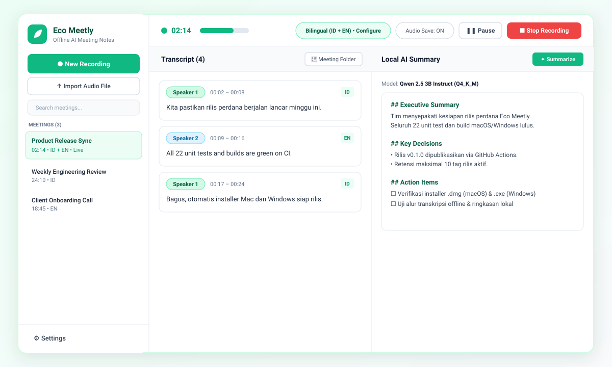

# Eco Meetly

**Privacy-First, 100% Offline AI Meeting Assistant** built with **Electron, Node.js, React, and Local AI**.

Eco Meetly captures your meetings, detects speaker turns offline, transcribes speech in real time using local **Whisper**, and generates structured summaries in the dominant language of your meeting using **built-in `llama.cpp` (GGUF)** or **Ollama**—all without your audio or transcripts ever leaving your machine.

<p align="center">
  
</p>

---

## Key Features

- **100% Offline & Local-First:** All audio capture, Voice Activity Detection (VAD), speech-to-text, speaker diarization, and AI summarization run locally on your device.
- **Offline Speaker Diarization (Chat-Style Transcript):** Automatically detects speaker changes (`Speaker 1`, `Speaker 2`, …) with 1 speaker and 1 sentence per bubble, plus click-to-rename speaker badges.
- **Granular Meeting Language Controls:**
  - **Primary Only (`fixed`):** Locks Whisper to your primary language (e.g., Indonesian) to prevent language drift.
  - **Bilingual (`primary + secondary`):** Smart auto-detection for mixed Indonesian–English meetings with automatic fallback.
  - **Full Auto-Detect (`auto`):** Unconstrained detection across all Whisper languages, with optional English translation.
- **Local AI Summaries (Dominant-Language Aware):**
  - Powered by built-in **`llama.cpp`** (GGUF models like Qwen 2.5 / Gemma 2) or **local Ollama**.
  - Automatically summarizes in the dominant language of the meeting (e.g., Indonesian for Indonesian meetings, English for English meetings).
  - Supports custom focus prompts, templates, and inline summary editing.
- **Full Storage & SSD Control:**
  - Choose a custom **AI Models Folder** (e.g., on an external SSD) for Whisper & GGUF models.
  - Choose a custom **Meeting Storage Folder** where `meeting-notes.md`, `transcript.txt`, `summary.md`, `summary_<timestamp>.md`, and optional `recording.wav` are automatically saved.
  - Toggle **Save Recorded Audio** on or off at any time.
- **MyEco Green UI:** Clean light and dark themes inspired by the MyEco emerald/forest green palette.

---

## Download (macOS & Windows)

Pre-built installers are published automatically on **GitHub Releases**:

| Platform | Package | Download |
| --- | --- | --- |
| **macOS (Apple Silicon & Intel)** | `.dmg` / `.zip` | [Download Latest macOS Release](../../releases/latest) |
| **Windows (x64)** | `.exe` (NSIS Installer) | [Download Latest Windows Release](../../releases/latest) |

> **macOS note:** If macOS Gatekeeper warns on an unsigned open-source build, right-click **Eco Meetly.app** → **Open**, or run `xattr -cr "/Applications/Eco Meetly.app"`.

---

## Development Setup

### Prerequisites
- **Node.js** 20+ (LTS)
- **npm** 10+
- **ffmpeg** installed on `PATH` (for importing `.mp3`, `.m4a`, `.ogg`, `.webm`, `.flac`)

### Commands
```sh
# Install dependencies
npm install

# Run in development mode (Vite + Electron)
npm run dev

# Run unit tests
npm test

# Typecheck & production build
npm run typecheck
npm run build

# Package desktop installer for current OS
npm run package
```

---

## Contributing & Release Workflow

We welcome contributions! Please read [CONTRIBUTING.md](CONTRIBUTING.md) for:
- **Conventional Commits** & **SemVer** rules (`feat:` → minor, `fix:`/`perf:`/`refactor:` → patch, `feat!:` → major).
- Pull request verification checklist.
- Automated GitHub Actions release pipeline (`.github/workflows/release.yml`), which builds macOS & Windows installers, includes commit history with clickable commit links in each release, and retains the latest **10 release tags**.

---

## License

MIT License.
